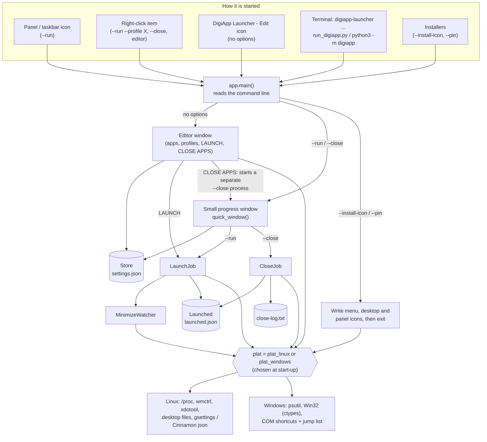
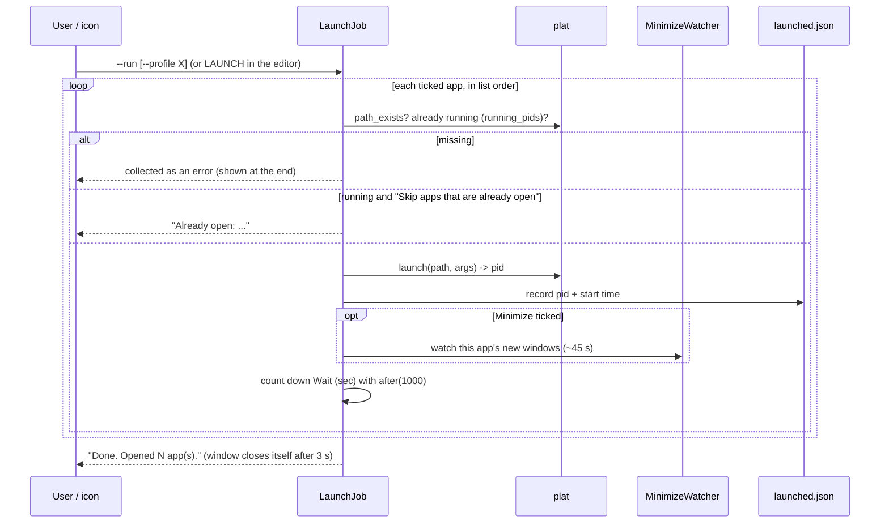
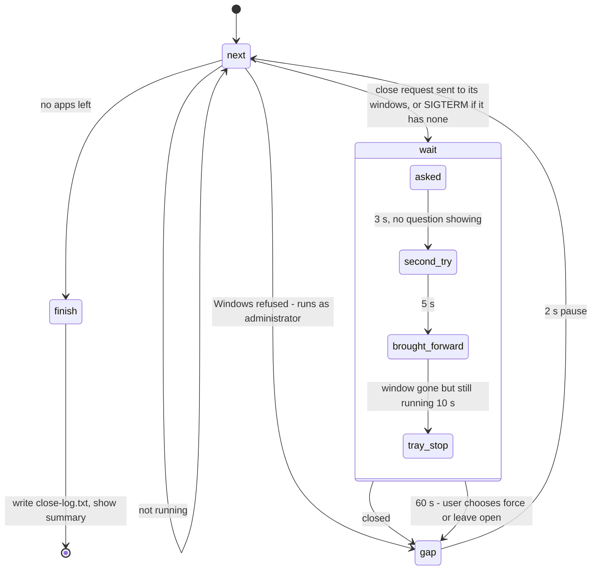
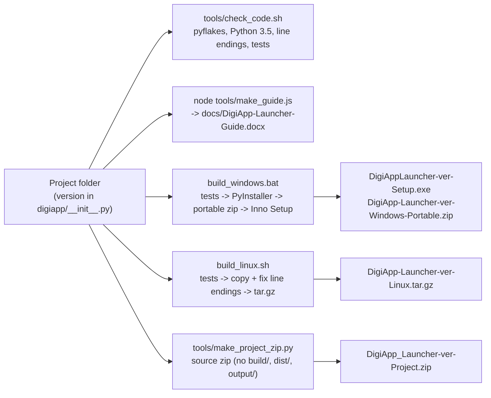

# DigiApp Launcher - Architecture

How the program is put together, for contributors. For *using* it see `docs/DigiApp-Launcher-Guide.pdf`;
for *building* it see `dev/BUILDING.md`; for what changed in each version see `CHANGELOG.md`.

Version described: **1.3.3** (2026-11-18). Colours and the light/dark rules: `dev/THEMES.md`.

---

## 1. What it does, and the rules it follows

DigiApp Launcher starts a list of programs (a **profile**) in order, waiting a set number of seconds after each,
and later closes them again in reverse order, politely, so each program can save its settings and ask its own
"Save changes?" questions. It is aimed at amateur-radio digital-mode stations (Flrig, JS8Call, Fldigi and helpers).

Design rules, in order of importance:

| Rule | Why | How |
|---|---|---|
| **One program for Windows and Linux** | One code base to fix | All logic in `digiapp/app.py`; everything system-specific behind one *platform module* (`plat_windows.py` / `plat_linux.py`) |
| **Never touch the wrong program** | Closing or minimizing another program loses the user's work | Conservative matching rules (section 6); no "any new window" guesses; browser pages are never closed |
| **Close politely** | Radio programs save settings and ask questions on exit | Window close request first, wait, bring the window forward, *ask* before forcing |
| **User data never in the program folder** | The program can be shared, rebuilt and installed for all users without anyone's settings | Settings in the user's own config folder (section 5) |
| **Linux: nothing to compile, old systems work** | Hams run older Ubuntu/Mint and Raspberry Pi | Plain Python **3.5+** (no f-strings), standard library + Tk, optional `wmctrl`/`xdotool` |
| **Windows: no Python needed by users** | Most Windows users won't install Python | One-file `DigiAppLauncher.exe` (PyInstaller) + Inno Setup installer |
| **No threads** | Tk is single-threaded; simpler to reason about | Every long job is a state machine driven by Tk `after()` timers |

---

## 2. Big picture

Every start is a **new, short-lived process**. There is no background service: the icon starts the program, it
does its one job (launch, close, or show the editor) and exits.

---

## 3. Source layout

| Path | Role |
|---|---|
| `run_digiapp.py` | Entry point (adds its folder to `sys.path`, calls `digiapp.app.main`). Also what PyInstaller builds from. |
| `digiapp/__init__.py` | `APP_TITLE`, `__version__`, `BUILD_DATE` - **the only place the version is set**; installers and build scripts read it. |
| `digiapp/__main__.py` | Allows `python3 -m digiapp`. |
| `digiapp/app.py` | Everything that is the same on both systems: settings (`Store`), recognising running apps, `LaunchJob`, `CloseJob`, `MinimizeWatcher`, `Launched`, the editor and the progress window, `main()`. |
| `digiapp/plat_linux.py` | Linux platform module (standard library only + optional `wmctrl`/`xdotool`). |
| `digiapp/plat_windows.py` | Windows platform module (`psutil`, `comtypes`, Win32 via `ctypes`). |
| `tests/test_core.py` | Self-tests (no windows opened); run by both build scripts. |
| `linux_install.sh`, `update_linux.sh`, `linux_uninstall.sh`, `install_linux_launcher.sh` | Linux install / update / remove / icons-for-this-folder. |
| `build_linux.sh` | Makes `DigiApp-Launcher-<ver>-Linux.tar.gz` (copies files, fixes line endings; nothing compiled). |
| `build_windows.bat`, `DigiAppLauncher.spec`, `DigiAppLauncher.iss` | Windows build: PyInstaller one-file exe, portable zip, Inno Setup installer. |
| `DigiApp.bat`, `digiapp.sh` | Run from the source folder without building. |
| `tools/` | `make_project_zip.py` (source zip), `make_portable_zip.py`, `make_guide.js` (Word guide), `make_icon.py`, `check_code.sh` (pyflakes, Python 3.5 check, line endings, tests), `mock_radio_app.py` (fake radio program for testing). |
| `docs/` | User guides (PDF) only. |
| `dev/` | `BUILDING.md`, `THEMES.md`, and the README texts that go inside the downloads. |

---

## 4. The platform module contract

`app.py` imports exactly one module as `plat` and only ever calls the names below. **Both modules must provide all
of them** with the same meaning; that is the whole porting surface.

| Group | Name | Meaning |
|---|---|---|
| Constants | `INTERPRETERS` | Program names that run a script (python, bash, sh, java, wine, cmd, powershell...) |
| | `FIRST_ICON_HELP` | Text shown after the first icon is made |
| Folders | `config_dir()` | Per-user settings folder |
| Start-up | `prepare_process()` | Windows: set AppUserModelID + DPI awareness. Linux: nothing |
| | `style_window(root, relaunch, icon, dark)` | Windows: dark or light title bar, taskbar icon, tie window to the pinned icon. Linux: nothing |
| Processes | `list_processes()` | `[Proc(pid, ppid, exe, cmdline, state)]` |
| | `is_alive(pid)`, `start_time(pid)` | Running? When did it start (to detect a reused pid)? |
| | `terminate(pids)` | Polite stop (Linux SIGTERM; Windows: nothing - closing goes through windows) |
| | `force_kill(pids)` | Last resort, only after the user says yes |
| | `norm(path)`, `base(path)` | Normalised full path; lower-case file name |
| Launching | `resolve(path)`, `path_exists(path)` | Full path of a program or bare command name |
| | `launch(path, args, minimize)` -> pid | Start a program detached from the launcher |
| | `run_detached(argv)` | Start another copy of the launcher (e.g. `--close`) |
| Windows | `windows_supported()`, `window_tool_note()` | Can windows be listed/closed? Hint if not (missing wmctrl, Wayland) |
| | `list_windows()` -> `[(id, pid, class_and_title)]` | Normal top-level windows. **pid may be 0** (Tk/Flatpak windows on Linux) |
| | `minimize_window(id)`, `close_window(id, method)` -> `'ok'/'denied'/'failed'`, `reveal_windows(ids)` | |
| | `window_busy(id)`, `window_info(id)` | Showing a question? Text for the log |
| Picking apps | `pick_file(parent, dir)`, `read_dropped(path)`, `installed_apps()`, `find_program(name)` | File dialog; shortcut / `.desktop` reading; menu programs; Find Missing Apps |
| Icons | `icon_installed()`, `refresh_menu(cmd, icon, entries, also_desktop)`, `pin_to_panel(add)` | Menu/desktop icons with the right-click list; panel/dock pinning |
| Optional | `flatpak_pids(app_id)` | Linux only; `app.py` uses `getattr`, so other platforms may omit it |
| | `clean_child_env()` | Called once Tk is running. Windows one-file exe: removes the `_MEI` temp-folder settings (`TCL_LIBRARY`, `TK_LIBRARY`, `_PYI_*`, PATH entries) from the environment and sets `PYINSTALLER_RESET_ENVIRONMENT=1`, so programs it starts - and its own restarts - never use or lock its temp folder. Linux: nothing |

---

## 5. Data

All files live in the **user's** config folder - Linux `~/.config/digiapp-launcher/`, Windows
`%APPDATA%\DigiApp Launcher\`. Nothing is written to the program folder.

| File | Written by | Contents |
|---|---|---|
| `settings.json` | `Store.save()` (atomic: write `.tmp`, then replace) | `DefaultProfile`, `LastLaunched`, `SkipRunning`, `Welcomed`, `Theme` (`Dark`/`Light`), `Profiles: [{Name, Apps: [{Enabled, Name, Path, Args, Delay, Minimize}]}]` |
| `launched.json` | `Launched.record()` after each start | `{"<Path>\n<Args>": [pid, start_time]}` - the copy of each app the launcher started; entries for ended programs are dropped |
| `close-log.txt` | `CloseJob.write_log()` | What each close found and did (kept to the last ~300 lines) - the first thing to ask for when "it didn't close" |

`Store.load()` cleans every value (`clean_app`), creates one empty "My Profile" for a new user, and on Windows also
reads the older PowerShell version's `DigiAppLauncher.json` placed next to the exe (same keys). Settings keys are shared with the
PowerShell version, so **add keys, never rename them**.

---

## 6. Recognising "this app is running"

This is the hardest part and the source of most past bugs. A profile entry only says *how to start* a program
(`Path` + `Args`); the running program can look quite different. `running_pids(app, procs)` combines:

1. **`find_app_pids`** - matching by program:
   - `app_target(app)` decides what to look for:
     - an interpreter (`python3`, `bash`, `sh`, `java`, `wine`, `cmd`...) -> the **script** in the options;
     - `bash -c 'cd DIR && python3 x.py'` -> parsed: `DIR/x.py`;
     - `flatpak run [opts] APP_ID` -> the **app id**; its processes are found through
       `/proc/<pid>/cgroup` containing `app-flatpak-APP_ID-` (the program itself runs as `bwrap`);
     - otherwise the program file itself.
   - A process matches if its executable, its first argument or (for scripts) any argument is that target.
   - If two list entries run the same program with different options, the options must match too.
2. **`Launched`** - the copy the launcher itself started, if that pid is still alive *with the same start time*.
   This catches helper scripts that hand over to another program (e.g. `~/.local/bin/fcc-lookup` -> `python3 FCC_Lookup.py`).

Windows belonging to the app (`app_windows`) are: windows owned by the app's processes **and everything they
started** (`family`), plus - only for windows that report **no** process - windows whose class/title contains the
program's file name / app id or the app's **name in the list** (5+ letters, never the launcher's own windows).

> Never add a rule like "any window that appeared after launch". It once minimized the wrong programs.

---

## 7. Launching

`MinimizeWatcher` remembers which windows and processes existed *before* the app started, then minimizes only the
app's *new* windows - and keeps re-minimizing for `SETTLE_SECONDS` (8 s) because some programs (Flrig) restore
themselves while starting.

---

## 8. Closing

"Close Open Apps" closes the **last launched** profile (`LastLaunched`), last app first, so rig control closes last.
`CloseJob` is a state machine ticked every 0.5 s:

In the `wait` state: `asked` = the close request went out; `second_try` = close again the way the window's X
button does (skipped while the app shows a question); `brought_forward` = the app's windows are brought to the
front so its question can be answered; `tray_stop` = the window is gone but the program still runs (a tray app),
so its processes are asked to stop. "Closed" means its processes are gone (window-only apps: its window is gone).

**Helpers don't hold up closing.** When the close request goes out, `CloseJob` notes which processes own the app's
windows (`win_owners`). If those have ended and the window is gone, anything left of the app never had a window - a
helper the program started (JS8Call runs a second `js8call.exe`, probably its decoder) or a one-file starter stub
(RigPanel, DigiApp Launcher itself: a starter `.exe` that runs the real program as a child). After `HELPER_GRACE`
(3 s) the app counts as closed and the next one starts; the helpers are asked to stop (Linux SIGTERM; Windows has no
gentle way, so they simply finish on their own). Nothing is forced. Tray apps are not affected: there the process
that owned the window is still running. Measured on Windows: JS8Call 25.4 s -> 3.8 s, RigPanel 9.9 s -> 3.8 s.

`close-log.txt` names every process found for an app (`pid = program options (started by ppid)`), which is how the
helpers above were identified.

Special cases:
- **Window only** - no process found, but a window carries the app's name: close that window and wait for it to go.
  There is nothing to force, so at the time limit it is reported "Left open".
- **No window** (background program) - ask its processes to stop straight away, 6-second limit.
- **Windows UIPI** - a normal program can't close a program running "as administrator"; detected
  (`close_window` -> `'denied'`) and explained to the user instead of retrying.
- Web pages a program opened in the browser are deliberately **not** closed (they would take the user's other tabs).

The editor's CLOSE APPS button doesn't close anything itself: it saves, then starts a separate
`--close --profile X` process, so closing behaves exactly the same from the editor and from the icon.

---

## 9. Desktop integration

The menu/taskbar icon *is* the user interface most of the time. Its right-click list is regenerated from
`Store.menu_entries()` (one item per profile, "Close Open Apps", "Edit apps and profiles...") on every save and
each time the editor opens.

| | Linux | Windows |
|---|---|---|
| Main icon | `~/.local/share/applications/digiapp-launcher.desktop` (+ copy on the desktop), `Exec=... --run` | Shortcuts with `--run` in the Start menu and on the desktop, AppUserModelID `DigiApp.Launcher` |
| Right-click list | `.desktop` **Actions** (`[Desktop Action itemN]`) | Taskbar **jump list** (`ICustomDestinationList`, COM) |
| Edit icon | `digiapp-launcher-edit.desktop` (menu + desktop), no options | "DigiApp Launcher - Edit" shortcut (no options, no AppUserModelID) |
| Panel / dock | Pinned automatically on Cinnamon (applet json + reload over D-Bus), GNOME and Unity (`gsettings`); instructions for KDE/XFCE/MATE | Windows doesn't allow self-pinning; the user pins the desktop icon |
| Grouping | `StartupWMClass=Digiapplauncher` | The process sets the AppUserModelID, so every launcher window groups under the pinned icon |
| Made by | `linux_install.sh` -> `run_digiapp.py --install-icon` and `--pin`; refreshed by the editor | Inno Setup `[Icons]` (all users) for a Setup install - the program then never writes its own desktop/Start-menu copies, and deletes old ones it made (they showed up late and twice). Portable: the editor's **Desktop Icon** button. Setup is recognised by `unins000.exe` next to the exe |

Known quirks: Cinnamon caches `.desktop` actions (Ctrl+Alt+Esc refreshes it); on Mint the panel right-click
"Edit" item did not open the editor (cause not found - the Edit icon is the workaround).

---

## 10. Look and feel

- **Two themes, one table each** (`THEMES` in `app.py`, same keys in both; a test checks it). `set_theme()` fills
  the shared table `C` in `main()` before any window is made; no colour is written anywhere else.
- **Fill colours and text colours are separate keys**: `Green`/`Yellow`/`Orange` are button and tick-box fills
  (black text), `GreenText`/`YellowText`/`OrangeText` are words on the window background (darkened in Light).
  `BlueTick` is the Minimize tick (black on bright blue in Dark, white on darker blue in Light).
- **Switching** = save, write `Theme`, start a new copy of the editor, close this one (`Editor.switch_theme`).
  The button (`☀ Light Theme` / `☾ Dark Theme`) sits at the right of the + Add App ... Find Missing Apps row.
- **One font family** (`Fonts`: Segoe UI on Windows, Ubuntu / DejaVu Sans on Linux) at a few sizes: 10 for text
  and buttons (program locations, options, status and wait times **bold** for readability), 11 for the profile
  name, tip and header readouts, 13 for LAUNCH / STOP / CLOSE APPS, 20 for the title. No typewriter font.
- Windows title bar follows the theme (`style_window(..., dark)`). Full standard for all the station apps,
  with both palettes: `dev/THEMES.md`.

---

## 11. Build and release pipeline

Linux users get the `.py` files themselves and run them with the system's Python; installing copies them to
`~/Applications/DigiApp-Launcher` (test versions before 1.2: `~/.local/share/digiapp-launcher`; or `~/Radio/DigiApp-Launcher` with `--radio`, or `--dest DIR`) and writes a
`~/.local/bin/digiapp-launcher` command. `update_linux.sh` finds the current install from the menu entry's `Exec=`
line and re-runs the installer with `--dest` there. Installers stop running copies first (`pkill`) - an old copy
left open would rewrite the icons back to itself.

Line endings are part of the build: `.sh` must be LF, `.bat` CRLF (`.gitattributes`, `make_project_zip.py`,
`build_linux.sh` and `check_code.sh` all enforce or check it). `DigiAppLauncher.iss` is CRLF too.

---

## 12. Testing

`tests/test_core.py` (33 tests) runs without opening windows (needs Tk importable - without Tk every test is *skipped*):

| Area | Covered |
|---|---|
| App targets | plain program, script through python, `bash -c 'cd ... && ...'`, `sh script`, `python3.12` as interpreter, Flatpak app id |
| Matching | same script with different options, by path, through bash, process families, windows by pid and by name |
| Settings | new user, cleaning old/odd values, menu entries, default wait, an unreadable settings file is kept, theme saved (old files get Dark), both themes have the same colour keys |
| Linux icons | Exec quoting, Actions, Edit icon contents, both icons written, own icons hidden from "installed apps", Cinnamon pin/unpin keeps other settings, Flatpak `@@` markers dropped, Flatpak cgroup lookup |
| Closing | `CloseJob` driven by a fake clock and fake system: window-only close (helper script), Flatpak tray app asked to stop, remembered launch copy, "not running", a windowless helper left by the window's program doesn't hold up closing (the JS8Call case) |

`tools/mock_radio_app.py` is a fake radio program for hands-on tests (`--ask` asks "Save changes?", `--slow N`,
`--popup` restores itself, `--class Tk`).

---

## 13. Extending

- **New setting per app or profile:** add it in `Store.clean_app` / `load` / `save` with a default (old files lack it),
  then the editor (`AppRow`), then the jobs. Keep existing key names.
- **New system behaviour:** add the function to **both** platform modules (section 4) - or use `getattr(plat, ...)`
  in `app.py` if it only makes sense on one system, as `flatpak_pids` does.
- **New way an app can disguise itself:** extend `app_target` / `find_app_pids` (process side) or `app_windows`
  (window side), add a test that reproduces the real process list and window list (copy them from `pgrep -af` /
  `wmctrl -lpx`, as the existing tests do), and make sure the rule can't match an unrelated program.
- **Python version:** Linux code must stay Python 3.5-compatible (`vermin` in `check_code.sh` checks it).
- **Version:** raise it in `digiapp/__init__.py` for every build that leaves your PC, and add a `CHANGELOG.md` entry.
