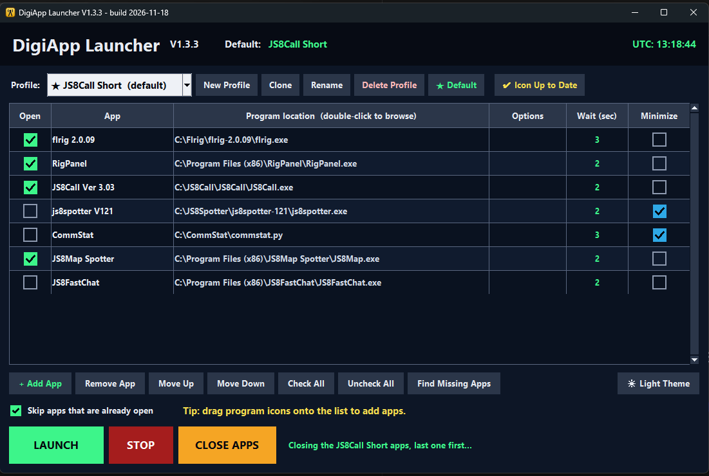

# DigiApp Launcher

Opens your digital-mode radio programs **in order**, waiting between each one so every program is
ready before the next starts - from one click on a gold taskbar / panel icon. Windows and Linux.
Free, from KW3KW (Ham Radio Made Simple): [website](https://hamradiomadesimple.github.io/) ·
[YouTube](https://www.youtube.com/@hamradiomadesimple).

**[Download the latest version](https://github.com/HamRadioMadeSimple/DigiApp-Launcher/releases/latest)** (Windows Setup, Windows portable, Linux)



- **Profiles** for different combinations (JS8 net, Fldigi messaging, ...): New, Clone, Rename, Delete, Set as Default
- Per app: **Open**, **wait time**, **Options**, **Minimize** (re-minimizes apps that pop themselves back up)
- **Close Open Apps** shuts everything down in **reverse order**, bringing up and waiting for any "Save changes?" question
- Taskbar / panel icon: **click** = default profile, **right-click** = other profiles, Close Open Apps, Edit
- A separate **DigiApp Launcher - Edit** icon (desktop and Start menu / app menu) opens the editor without launching anything
- Pick programs from the installed-apps list, browse, or drag and drop; Find Missing Apps; auto-save
- **Light or dark** look - one click on the Light Theme / Dark Theme button
- Settings live in the user's own folder, never with the program - builds and downloads carry no personal data

## For users

| | Download | Install |
|---|---|---|
| Windows 10/11 | `DigiAppLauncher-<ver>-Setup.exe` (or the portable zip) | run it |
| Linux (Ubuntu 16.04+, Mint, Debian, Fedora, Arch, openSUSE, Raspberry Pi OS...) | `DigiApp-Launcher-<ver>-Linux.tar.gz` | save it in Downloads, then paste the three lines below in a terminal |

All downloads are on the [Releases](https://github.com/HamRadioMadeSimple/DigiApp-Launcher/releases/latest) page. Windows may show a SmartScreen warning because the
program isn't code-signed yet: click **More info > Run anyway**.

Linux install (or update) - open a terminal with Ctrl+Alt+T and paste all three lines at once:

```bash
F="$(ls -t ~/Downloads/DigiApp-Launcher-*-Linux*.tar.gz | head -n 1)"
tar -xzf "$F" -C ~/Downloads
bash ~/Downloads/"$(tar -tzf "$F" | head -n 1 | cut -d/ -f1)"/update_linux.sh
```

It installs into `~/Applications/DigiApp-Launcher` and adds the menu, desktop and panel icons
(`bash linux_install.sh --radio` in the unpacked folder puts it in `~/Radio` instead).

**Guides (PDF):** [Install and User Guide](docs/DigiApp-Launcher-Guide.pdf) ·
[Installing on Linux (one page)](docs/Installing_DigiApp_Launcher_on_Linux.pdf). Short text versions:
[`docs/README-Windows.txt`](docs/README-Windows.txt), [`docs/README-Linux.txt`](docs/README-Linux.txt).

## Testers and feedback

Found a bug or have an idea? Open an [issue](https://github.com/HamRadioMadeSimple/DigiApp-Launcher/issues) and include:
- DigiApp Launcher version (shown in the editor title bar) and Windows / Linux version
- What you clicked, what you expected, and what happened
- For closing problems on Linux: the last lines of `~/.config/digiapp-launcher/close-log.txt`
  (on Windows: `%APPDATA%\DigiApp Launcher\close-log.txt`)

## For building

How the program is put together: [`docs/ARCHITECTURE.md`](docs/ARCHITECTURE.md). Building: [`docs/BUILDING.md`](docs/BUILDING.md). Helping: [`CONTRIBUTING.md`](CONTRIBUTING.md). In short: `build_windows.bat` on Windows, `bash build_linux.sh` on Linux;
results go to `output/`. The version is set in `digiapp/__init__.py`. On GitHub, publishing a release with the tag
`v<version>` builds and attaches the Setup.exe, the portable zip and the Linux `.tar.gz` (`.github/workflows/release.yml`);
the self-tests run on every push (`tests.yml`).

## Project layout

| Path | What it is |
|---|---|
| `run_digiapp.py` | starts the program (`--run`, `--close`, `--profile NAME`, `--install-icon`, `--pin`) |
| `digiapp/app.py` | the program: settings, editor window, launching, minimizing, closing |
| `digiapp/plat_windows.py` | Windows parts: taskbar right-click list (jump list), shortcuts, window control |
| `digiapp/plat_linux.py` | Linux parts: menu entry + right-click actions, panel/dock pinning, wmctrl/xdotool |
| `DigiAppLauncher.spec` / `.iss` / `build_windows.bat` | Windows program, installer, build |
| `build_linux.sh`, `linux_install.sh`, `update_linux.sh`, `linux_uninstall.sh`, `install_linux_launcher.sh` | Linux build and install scripts |
| `DigiApp.bat`, `digiapp.sh` | run from this folder without building |
| `docs/` | user guides (PDF), readmes, BUILDING.md, ARCHITECTURE.md, THEMES.md |
| `.gitattributes` | keeps `.sh` files LF and `.bat` files CRLF |
| `tests/` | self-tests (run by both builds) |
| `tools/` | mock radio app for testing, icon and guide generators, code checks, project zip |
| `examples/` | example profiles file |
| `.github/workflows/` | GitHub: self-tests on every push, release builds |
| `build/`, `dist/`, `output/` | created by the builds (not kept in version control) |

## License

MIT - see [`LICENSE`](LICENSE). Free to use, change and share; keep the copyright notice.
Credits for the tools in the ready-built downloads: [`NOTICE.md`](NOTICE.md).

## More free ham radio software from KW3KW

[RigPanel](https://github.com/HamRadioMadeSimple/RigPanel) ·
[Flrig EMCOMM](https://github.com/HamRadioMadeSimple/Flrig-EMCOMM) ·
[JS8Map Spotter](https://github.com/HamRadioMadeSimple/JS8MapSpotter) ·
[JS8MapChat](https://github.com/HamRadioMadeSimple/JS8MapChat) ·
[FCC Lookup](https://github.com/HamRadioMadeSimple/FCC_Lookup) - all on
[hamradiomadesimple.github.io](https://hamradiomadesimple.github.io/). DigiApp Launcher can start any of them.

73 de KW3KW
